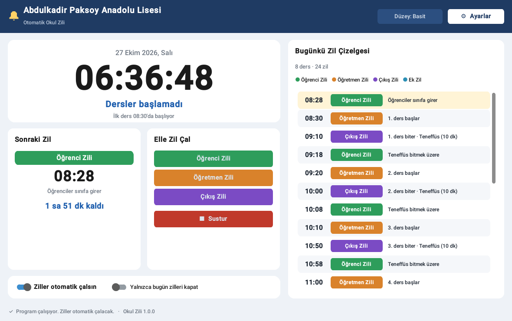
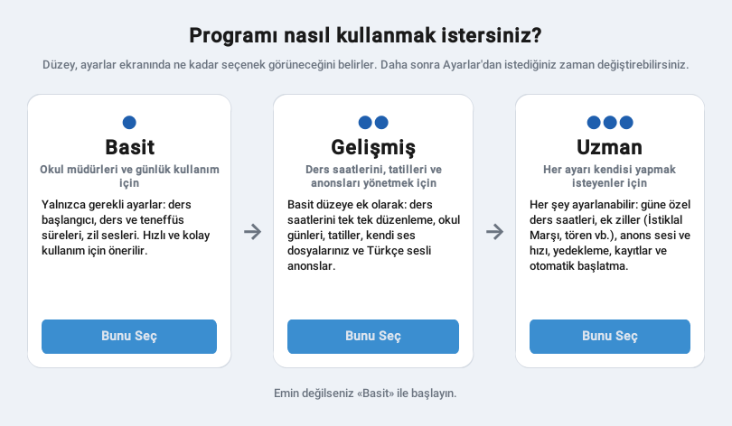
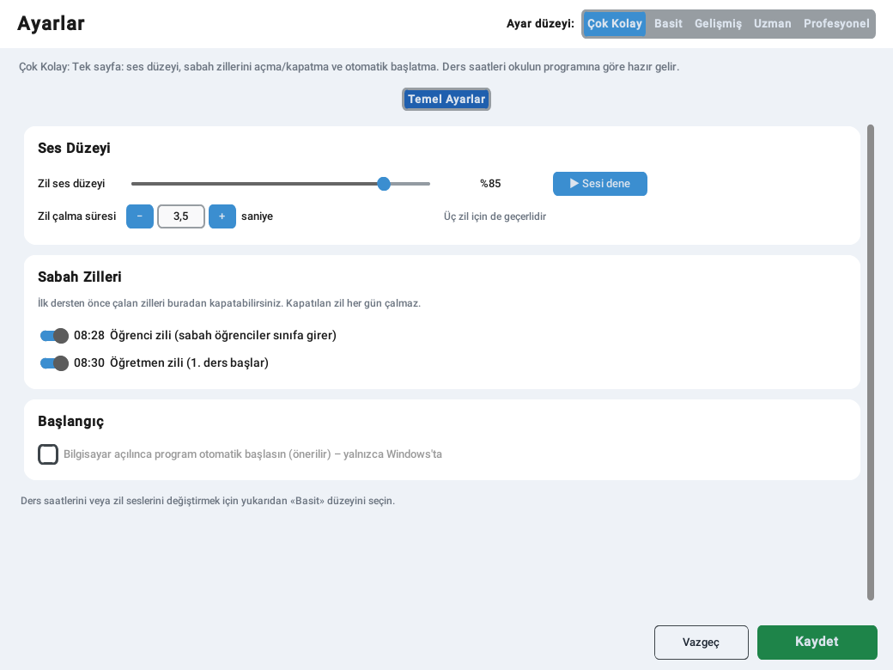
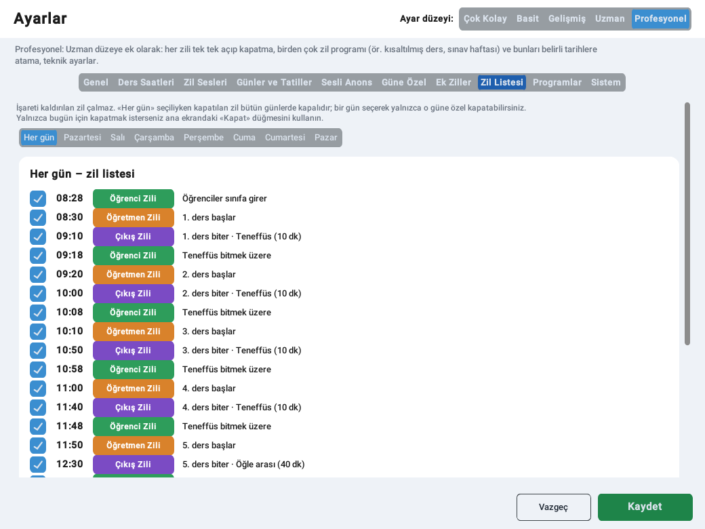
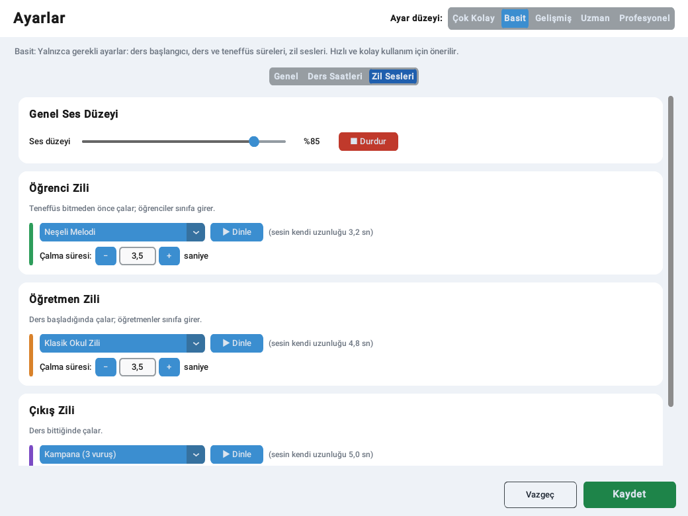
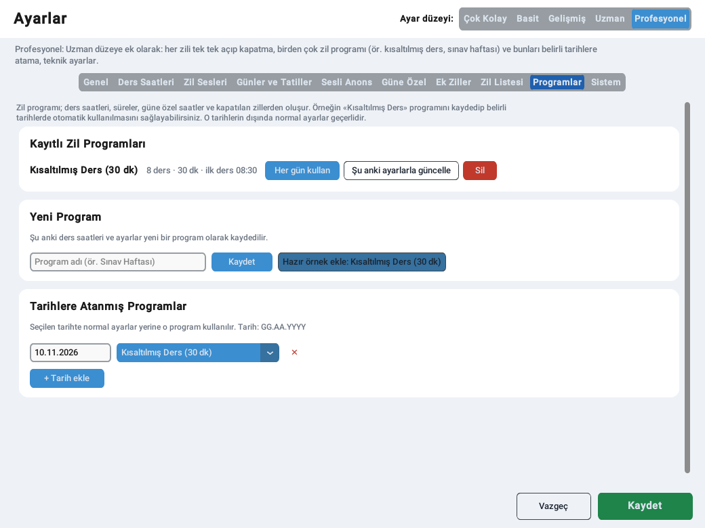

# Okul Zili – Abdulkadir Paksoy Anadolu Lisesi

Okul zillerini ders programına göre otomatik çalan, Türkçe arayüzlü masaüstü programı.



## Özellikler

- **Otomatik ziller:** Her ders için üç zil çalar:
  - **Öğrenci Zili:** Teneffüs bitmeden 2 dakika önce (süre ayarlanabilir). Öğrenciler sınıfa girer.
  - **Öğretmen Zili:** Ders başladığında. Öğretmenler sınıfa girer.
  - **Çıkış Zili:** Ders bittiğinde.
- **Hazır zil sesleri:** Klasik okul zili, Ding-Dong, Westminster çan melodisi, neşeli melodi,
  elektronik zil, gong, kampana ve kısa bip. Ek dosya gerekmez. Her zil türüne farklı bir ses verilebilir.
- **Türkçe sesli anons (isteğe bağlı):** Zilden sonra örneğin *«Sayın öğretmenlerimiz, üçüncü ders
  başlamıştır.»* gibi bir anons okunur. Metinler düzenlenebilir.
- **Beş ayar düzeyi:** **Çok Kolay → Basit → Gelişmiş → Uzman → Profesyonel**
- **Zil çalma süresi:** Her zilin kaç saniye çalacağı ayarlanır (varsayılan **3,5 sn**, en az 0,5, en çok **30 sn**).
  Ses bu süreden kısaysa başa sarılarak tekrarlanır, uzunsa süre dolunca yumuşakça kısılarak durur.
  Anons, zil bittikten sonra okunur.
- **Sabah zilleri kapatılabilir:** 08:28 öğrenci zili ve 08:30 öğretmen zili ayrı ayrı açılıp kapatılabilir
  (her düzeyde, Ayarlar → Sabah Zilleri).
- **Zilleri tek tek kapatma:** Ana ekrandaki «Kapat» düğmesiyle herhangi bir zil yalnızca bugün için
  susturulur (Gelişmiş ve üstü). Profesyonel düzeyde ziller kalıcı olarak, her gün ya da belirli bir gün için kapatılabilir.
- Elle zil çalma, anlık anons, «Sustur» düğmesi, «yalnızca bugün zilleri kapat» anahtarı.
- Açık ve koyu tema. Program kapatılmak istendiğinde uyarı verir.

## Ayar düzeyleri



| Düzey | Görünen ayarlar |
|---|---|
| **Çok Kolay** | Tek sayfa: ses düzeyi, zil çalma süresi (üç zil için tek ayar), sabah zillerini (08:28 / 08:30) açma-kapatma, otomatik başlatma |
| **Basit** | Okul adı, tema, ilk ders saati, ders, teneffüs ve öğle arası süreleri, öğrenci zilinin kaç dakika önce çalacağı, hazır zil sesleri, her zilin çalma süresi, ses düzeyi |
| **Gelişmiş** | Basit düzeydekilere ek olarak: ders saatlerini tek tek girme, kendi ses dosyalarınız (MP3/WAV/OGG), okul günleri, tatiller (resmî tatilleri tek tıkla ekleme), Türkçe sesli anonslar ve metinleri |
| **Uzman** | Gelişmiş düzeydekilere ek olarak: güne özel ders saatleri (ör. Cuma erken çıkış), ek ziller (bayrak töreni vb.), ek zillerin çalma süresi, zile özel ses düzeyi, anons motoru, hızı ve ses düzeyi, ayarları yedekleme/geri yükleme, kayıtlar |
| **Profesyonel** | Uzman düzeydekilere ek olarak: **Zil Listesi** (günün her zilini tek tek, her gün için ya da belirli bir gün için kapatma), **Zil Programları** (ör. «Kısaltılmış Ders», «Sınav Haftası» programlarını kaydetme, her gün kullanma veya belirli tarihlere atama), teknik ayarlar |

Düzey yalnızca **neyin görüneceğini** belirler. Üst düzeyde yapılan ayarlar düzey düşürülse de geçerli kalır.
Kapatılan ziller ana ekranda gri ve «Kapalı» olarak görünmeye devam eder.

| Çok Kolay | Profesyonel – Zil Listesi |
|---|---|
|  |  |

| Zil Sesleri ve çalma süresi | Profesyonel – Zil Programları |
|---|---|
|  |  |

## Varsayılan zil çizelgesi

Okulun 10G ders programına göre (Pazartesi–Cuma):

| Ders | Öğrenci Zili | Öğretmen Zili (başlangıç) | Çıkış Zili (bitiş) | Sonrasında |
|---|---|---|---|---|
| 1 | 08:28 (kapatılabilir) | 08:30 (kapatılabilir) | 09:10 | 10 dk teneffüs |
| 2 | 09:18 | 09:20 | 10:00 | 10 dk teneffüs |
| 3 | 10:08 | 10:10 | 10:50 | 10 dk teneffüs |
| 4 | 10:58 | 11:00 | 11:40 | 10 dk teneffüs |
| 5 | 11:48 | 11:50 | 12:30 | 40 dk öğle arası |
| 6 | 13:08 | 13:10 | 13:50 | 10 dk teneffüs |
| 7 | 13:58 | 14:00 | 14:40 | 10 dk teneffüs |
| 8 | 14:48 | 14:50 | 15:30 | Okul dağılır |

## Kurulum (Windows)

### Seçenek 1: Tek dosya (.exe) oluşturma

1. [python.org](https://www.python.org/downloads/) adresinden Python 3.10 veya üstünü kurun
   (kurulumda **«Add Python to PATH»** kutusunu işaretleyin).
2. Bu klasördeki **`build_windows.bat`** dosyasına çift tıklayın.
3. İşlem bitince **`dist\OkulZili.exe`** dosyası oluşur. Bu dosyayı zil bilgisayarına kopyalamanız yeterlidir.

### Seçenek 2: Doğrudan çalıştırma

Python kuruluysa **`baslat.bat`** dosyasına çift tıklayın. İlk açılışta gerekli paketler otomatik yüklenir.

### Öneriler

- Ayarlar → Genel bölümünde **«Bilgisayar açılınca program otomatik başlasın»** seçeneğini işaretleyin.
- Zil bilgisayarında uyku modunu kapatın. Program yalnızca açıkken zil çalabilir.
- Sesli anonslar ilk kez internet bağlantısıyla hazırlanır ve bilgisayara kaydedilir. Sonra internet
  olmadan da çalar. İnternet hiç yoksa Uzman düzeyde «Windows sesleri» motoru seçilebilir. Türkçe
  telaffuz için Windows'a Türkçe konuşma paketi yüklü olmalıdır.

## Veriler

Ayarlar, hazır sesler, anons önbelleği ve kayıtlar `%APPDATA%\OkulZili` klasöründe tutulur.
Programın yanına `tasinabilir.txt` adlı boş bir dosya koyarsanız veriler programın yanındaki
`veriler` klasörüne yazılır (USB bellekte taşımak için).

## Geliştirici notları

```
python main.py                          # programı başlatır
python -m unittest discover -s tests    # testleri çalıştırır
```

| Dosya | Görevi |
|---|---|
| `okul_zili/config.py` | Varsayılan ayarlar, kaydetme ve yükleme |
| `okul_zili/schedule.py` | Ders saatlerinden günlük zil listesini hesaplar |
| `okul_zili/scheduler.py` | Saati izler, zamanı gelen zili çalar |
| `okul_zili/audio.py` | Zil ve anonsları sırayla çalar (pygame) |
| `okul_zili/sounds.py` | Hazır zil seslerini üretir |
| `okul_zili/tts.py` | Türkçe sesli anons (edge-tts / pyttsx3) |
| `okul_zili/ui/` | Arayüz (customtkinter) |
